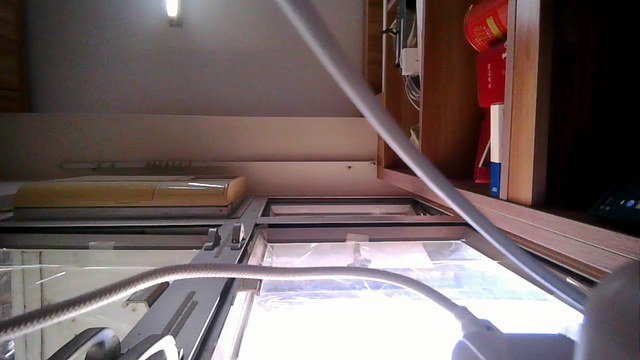
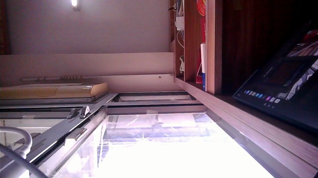
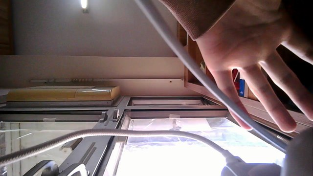
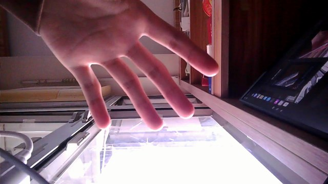
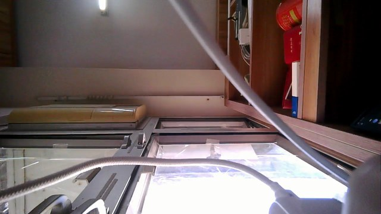
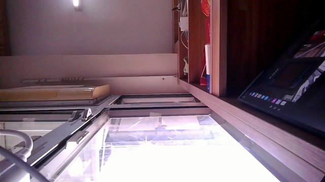

# CIS Split PNG

Independent terminal tool for splitting a side-by-side CIS video into two
PNG image directories.

## Example output

The examples below come from the real
`2026-11-17_15-22-09` stereo CIS capture. Each preview links to the original
1280x720 PNG.

| Frame | Left | Right |
|---|---|---|
| `000000` | [](examples/2026-11-17_15-22-09/images_rectified_left/000000.png) | [](examples/2026-11-17_15-22-09/images_rectified_right/000000.png) |
| `000100` | [](examples/2026-11-17_15-22-09/images_rectified_left/000100.png) | [](examples/2026-11-17_15-22-09/images_rectified_right/000100.png) |
| `000213` | [](examples/2026-11-17_15-22-09/images_rectified_left/000213.png) | [](examples/2026-11-17_15-22-09/images_rectified_right/000213.png) |

The first-stage output contains only:

```text
<output-dir>/
├── images_rectified_left/
│   ├── 000000.png
│   ├── 000001.png
│   └── ...
└── images_rectified_right/
    ├── 000000.png
    ├── 000001.png
    └── ...
```

The directory names follow the requested DSEC-style convention, but this tool
currently performs only stereo splitting and PNG conversion. It does not
perform geometric rectification or create timestamps, calibration, event
HDF5 files, disparity maps, or other DSEC metadata.

## Requirements

- Python 3.10 or newer
- FFmpeg and ffprobe available on `PATH`

The tool itself uses only the Python standard library.

## Run without installation

```bash
/home/astri/cis_split_png/bin/cis_split_png \
  -i /home/astri/2026-11-17_15-22-09 \
  -o /home/astri/cis_png_2026-11-17_15-22-09
```

`-i` accepts either a video file or a `sensor_studio` session directory
containing `cis/stereo.mkv`.

The default layout assumes horizontal stereo, with the first half written as
left and the second half written as right. Each view is converted to 8-bit RGB
PNG without resizing.

## Options

```text
-i, --input FILE_OR_SESSION    Input video or session directory
-o, --output-dir DIR           Output directory for the two image folders
--split-x PIXEL                Override the default half-width split
--swap                         Treat the first half as right
--overwrite                    Replace existing image output folders
--dry-run                      Validate and print the plan without writing
```

Use `--dry-run` first when checking a new capture:

```bash
/home/astri/cis_split_png/bin/cis_split_png \
  -i /home/astri/2026-11-17_15-22-09 \
  -o /home/astri/cis_png_2026-11-17_15-22-09 \
  --dry-run
```

Without `--overwrite`, existing `images_rectified_left` or
`images_rectified_right` directories cause an error. With `--overwrite`, only
those two directories are replaced. Unrelated files in the output directory
are preserved.

Output is staged in a temporary directory and published only after FFmpeg
finishes and both image sets pass frame-count, filename-sequence, and PNG
dimension checks.

## Install as a command

```bash
cd /home/astri/cis_split_png
/home/astri/myenv/bin/python -m pip install -e .
```

After installation:

```bash
cis_split_png -i INPUT -o OUTPUT_DIR
```

## Test

```bash
cd /home/astri/cis_split_png
PYTHONPATH=src /home/astri/myenv/bin/python -m unittest discover -s tests -v
```
